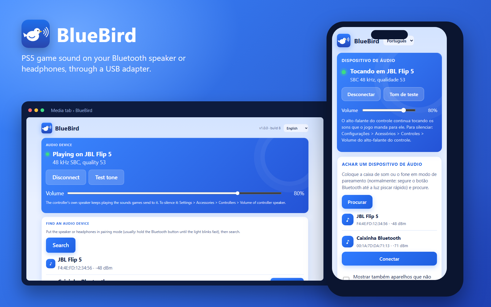
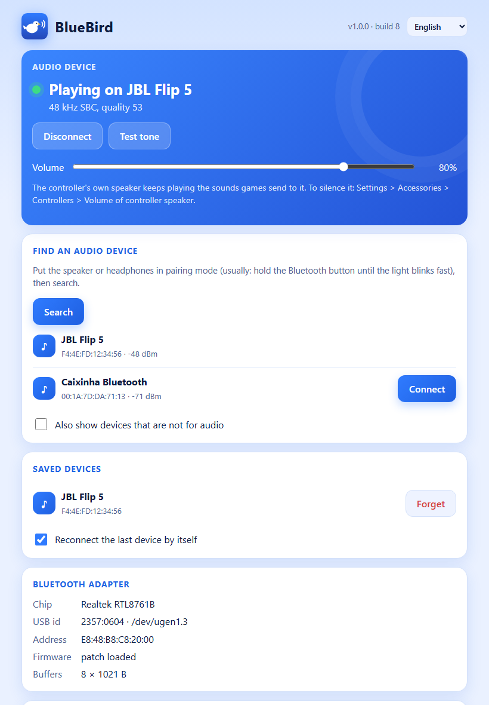
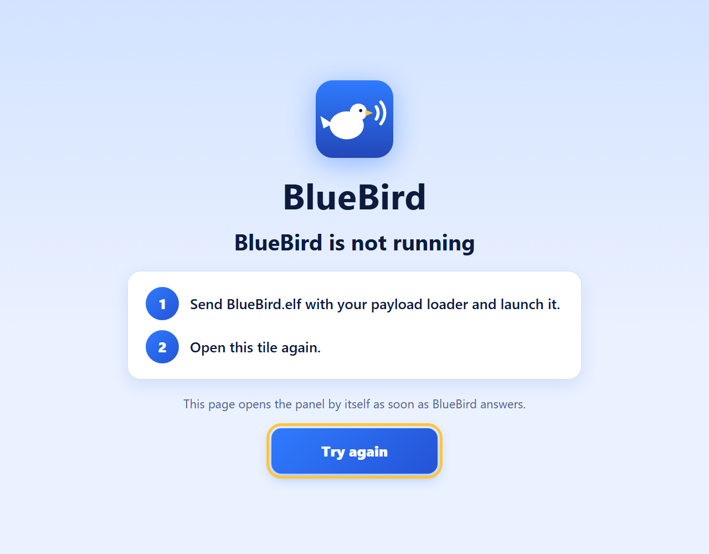

<p align="center">
  
</p>

<h1 align="center">BlueBird</h1>

<p align="center">
  <b>Your PS5's game sound on a Bluetooth speaker or headphones.</b><br>
  A payload for jailbroken PS5 consoles that streams audio through a plain USB Bluetooth adapter.
</p>

<p align="center">
  <a href="https://github.com/jpemendonca/BlueBird/releases/latest"></a>
  <a href="https://github.com/jpemendonca/BlueBird/actions/workflows/ci.yml"></a>
  
  
</p>

<p align="center">
  
</p>

## Why BlueBird

- **Your own adapter, never the console's radio.** BlueBird drives a separate USB Bluetooth adapter. The PS5's internal Bluetooth stays with the DualSense, which keeps working exactly as before.
- **Plug and play adapters.** Realtek RTL8761B sticks (TP-Link UB500 and friends) get their firmware from BlueBird; generic "CSR 4.0" dongles work as they are.
- **Pair once.** Next time, switch the speaker or headphones on and BlueBird connects to them by itself.
- **A dashboard where you need it.** A tile in the Media tab, or `http://<PS5_IP>:8120` on your phone, in English, Português, Español, Français, Deutsch, Русский and 日本語.
- **Steady sound.** A small buffer absorbs hiccups, and when the link gets weak BlueBird lowers the quality for a moment instead of cutting out.

## Quick start

1. Download `BlueBird.elf` from the [latest release](https://github.com/jpemendonca/BlueBird/releases/latest).
2. Send it to your payload loader and **launch it**. A notification says *BlueBird … running*.
3. Plug a USB Bluetooth adapter into the PS5. A notification says *Bluetooth adapter ready*.
4. Open the **BlueBird** tile in the Media tab, or `http://<PS5_IP>:8120` on your phone.
5. Put the speaker or headphones in pairing mode, press **Search**, then **Connect**. A notification says *Playing on …*, and the game sound comes out of it.

Portuguese guide: [docs/COMECE_AQUI.md](docs/COMECE_AQUI.md).

<p align="center">
  
  &nbsp;
  
</p>

Opened while BlueBird is not running, the tile explains how to start it, and opens the dashboard by itself once BlueBird answers. The console's browser keeps that page after the tile was opened once with BlueBird running.

## Good to know

- **The controller's speaker still plays its own sounds.** Some games send sounds to the DualSense's speaker, and the PS5 keeps playing them there: BlueBird carries the console's main sound, and the PS5 does not mix the controller's sounds into it. If that bothers you, turn it off in **Settings › Accessories › Controllers › Volume of controller speaker**.
- **The TV keeps playing too.** BlueBird takes a copy of the sound; turn the TV down.
- **Bluetooth has some delay**, about 150 to 250 ms depending on the speaker or headphones.
- **Running OmniPad CE too?** Each payload needs its own adapter: plug in two, and pick which one BlueBird uses under **Bluetooth adapter** on the dashboard.

## Adapters

| Adapter | Chip | Status |
|---|---|---|
| TP-Link UB500 (`2357:0604`) | Realtek RTL8761B | ✅ Tested on a PS5: firmware loaded by BlueBird |
| Other RTL8761B / RTL8761BU sticks | Realtek RTL8761B | Expected to work: same firmware |
| Generic "CSR 4.0" dongles (`0a12:0001`) | CSR8510 or a clone | Expected to work: no firmware needed |
| Other Realtek chips (RTL8821C, RTL8822B, …) | Realtek | Not yet: each needs its own firmware |
| LE-only sticks | — | Refused: audio needs Bluetooth Classic |

## Something wrong?

Open **Help** on the dashboard:

- **Send report** sends the BlueBird log and diagnostics to the developer and shows a short code. Put that code in an issue or a message, so your report can be found.
- **Copy diagnostics** copies the same text, to paste into a [GitHub issue](https://github.com/jpemendonca/BlueBird/issues).

**About reports.** Nothing leaves your console unless you press Send. A report holds the BlueBird log, the diagnostics text (adapter, audio device, stream numbers), the BlueBird version and build, the console firmware, and the message you choose to add. MAC addresses are cut to their first three bytes, the part that names the maker, before the report is saved. Reports go to a small API run by the maintainer on Cloudflare Workers, the same one OmniPad CE uses, over HTTPS, and are stored in a Cloudflare database. Only the maintainer, and the AI tools used to develop BlueBird, read them. Each report is deleted after 90 days. Your IP address is not stored: only a salted hash of it, kept for up to two days, to limit how often one address can send. To have a report deleted sooner, quote its code in an issue.

## How it works

The console's audio is captured as Remote Play gets it, encoded to SBC, and streamed over A2DP by BlueBird's own Bluetooth host, on the USB adapter. Details in [SPECS.md](SPECS.md).

## Build

In WSL Ubuntu:

```bash
sudo sh tools/setup-wsl-toolchain.sh
```

```bash
sh tools/get-bt-firmware.sh
```

```bash
make test && export PS5_PAYLOAD_SDK=/opt/ps5-payload-sdk && make
```

The payload is `dist/BlueBird.elf`. To work on the dashboard without a PS5, run `python tools/mock_dashboard.py` and open `http://localhost:8120/`.

## Credits and licence

GPL-3.0-or-later. The USB adapter transport and the Realtek loader come from [OmniPad CE](https://github.com/jpemendonca/OmniPad-CE); the SBC encoder, the audio capture calls and the idea of the tile's offline page from [HearBridge-PS5](https://github.com/X-F1REBALL-X/HearBridge-PS5) by X-F1REBALL-X. The Realtek firmware is from linux-firmware. See [docs/THIRD_PARTY.md](docs/THIRD_PARTY.md).
