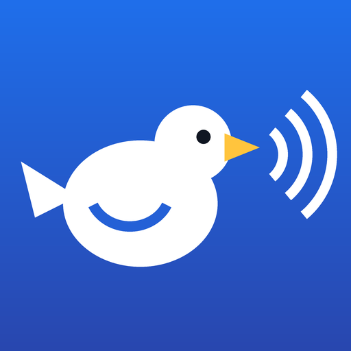

<p align="center"></p>

# BlueBird

Play your PS5's game and system sound on a Bluetooth speaker or headphones, through a USB Bluetooth adapter. A payload for jailbroken PS5 consoles.

- **Your own adapter, never the console's radio.** The DualSense keeps the PS5's Bluetooth to itself and works as usual.
- **Plug and play adapters.** Realtek RTL8761B sticks (TP-Link UB500 and friends) get their firmware from BlueBird; generic "CSR 4.0" dongles work as they are.
- **Pair once.** Next time, switch the speaker on and BlueBird calls it by itself.
- **A simple dashboard** in the Media tab, or on your phone at `http://<PS5_IP>:8120`.

> **Status: 0.1.0, first build.** Everything was tested on a PC against a simulated adapter and speaker. It has not been run on a PS5 yet.

## Use

1. Download `BlueBird.elf` from the latest release.
2. Send it to your payload loader and start it. The notification "BlueBird … running" appears.
3. Plug a USB Bluetooth adapter into the PS5. "Bluetooth adapter ready" appears.
4. Open the **BlueBird** tile in the Media tab (or `http://<PS5_IP>:8120` on your phone).
5. Put the speaker in pairing mode, press **Search**, then **Connect** next to it. "Playing on …" appears.

The TV keeps its sound too: turn it down on the TV. The controller's own speaker keeps working, since nothing is plugged into the controller.

## Adapters

| Adapter | Chip | Status |
|---|---|---|
| TP-Link UB500 (`2357:0604`) | Realtek RTL8761B | Expected to work: firmware embedded |
| Other RTL8761B / RTL8761BU sticks | Realtek RTL8761B | Expected to work: same firmware |
| Generic "CSR 4.0" dongles (`0a12:0001`) | CSR8510 or a clone | Expected to work: no firmware needed |
| Other Realtek chips (RTL8821C, RTL8822B, …) | Realtek | Not yet: each needs its own firmware |
| LE-only sticks | — | Refused: audio needs Bluetooth Classic |

Running OmniPad CE too? Each payload needs its own adapter: plug in two, and pick which one BlueBird uses under **Bluetooth adapter** on the dashboard.

## Build

In WSL Ubuntu:

```bash
sudo sh tools/setup-wsl-toolchain.sh
```

```bash
sh tools/get-bt-firmware.sh
```

```bash
make test && export PS5_PAYLOAD_SDK=/opt/ps5-payload-sdk && make
```

The payload is `dist/BlueBird.elf`. To work on the dashboard without a PS5, run `python tools/mock_dashboard.py` and open `http://localhost:8120/`.

## How it works

The console's audio is captured as Remote Play gets it, encoded to SBC, and sent over A2DP by BlueBird's own Bluetooth host, on the USB adapter. Details in [SPECS.md](SPECS.md).

## Credits and licence

GPL-3.0-or-later. The USB adapter transport and the Realtek loader come from [OmniPad CE](https://github.com/jpemendonca/OmniPad-CE); the SBC encoder and the audio capture calls from [HearBridge-PS5](https://github.com/X-F1REBALL-X/HearBridge-PS5) by X-F1REBALL-X. The Realtek firmware is from linux-firmware. See [docs/THIRD_PARTY.md](docs/THIRD_PARTY.md).
